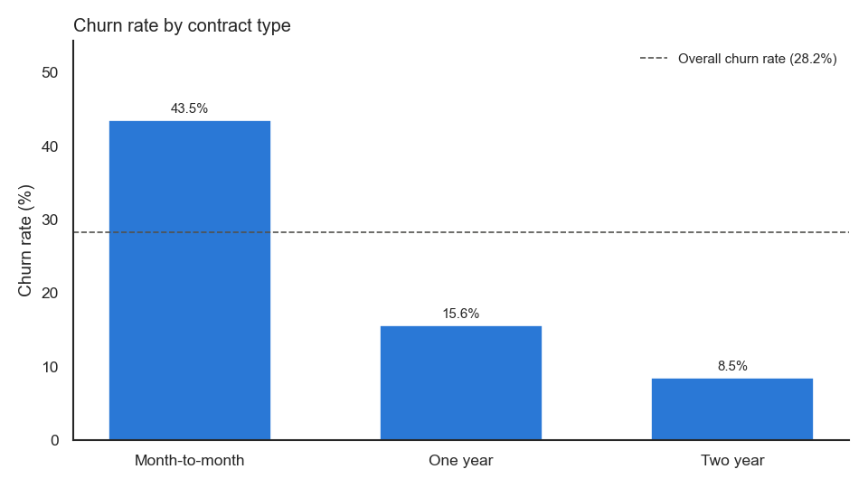
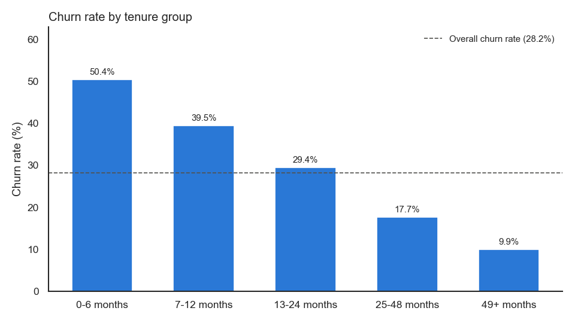
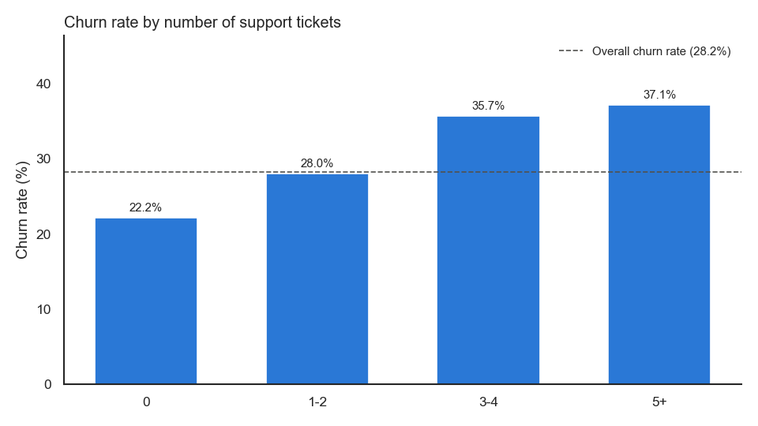
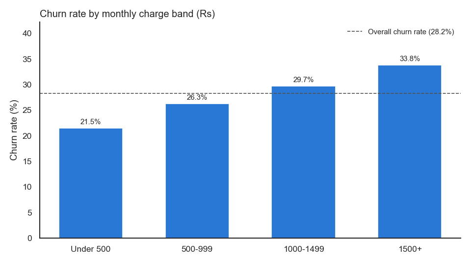

# Customer Churn & Retention Analysis

## Objective

This project looks at which customers of a fictional telecom and broadband company leave (churn) and which customer groups the business should focus on to keep more customers. I cleaned the data and analyzed it with Python (pandas) and PostgreSQL, created charts with Matplotlib and Seaborn, and designed a 3-page Power BI report structure with DAX measures.

This project uses a synthetic customer dataset created for Data Analyst portfolio practice. It does not come from a real company.

## Business problem

A subscription company loses monthly revenue every time a customer leaves. In this project, the company knows its overall churn is high but not where it comes from. I wanted to answer:

- What is the churn rate?
- Which contract types, tenure groups, payment methods, services and segments churn more?
- Do support tickets and higher bills go with higher churn?
- Which customers should the retention team look at first?

The full list with answers is in [docs/business_questions.md](docs/business_questions.md).

## Dataset (synthetic)

This project uses a synthetic customer dataset created for Data Analyst portfolio practice. It represents a fictional Indian telecom company, so the findings are patterns in this dataset, not results from a real business. The raw file includes duplicates, missing values, inconsistent text and wrong values to practice cleaning. `src/generate_data.py` recreates it.

- Raw file: 4,057 rows. Cleaned file: 3,990 customers (one row per customer)
- Columns: customer_id, gender, age, tenure_months, contract_type, monthly_charges, total_charges, payment_method, service_type, internet_service, support_tickets, usage_frequency, region, customer_segment, churn
- Charges are in Rupees (Rs). `usage_frequency` is the number of days the customer used the service in the last 30 days.
- Added during cleaning: tenure_group, charge_band, support_ticket_band

## Tools used

Python (pandas, NumPy, Matplotlib, Seaborn, Jupyter), PostgreSQL, Power BI report design, DAX

## Data cleaning

`src/data_cleaning.py` prints each step so the results can be checked.

| Problem | Rows | Fix |
|---|---|---|
| Exact duplicate rows | 45 | Removed |
| Same customer twice with different text case | 12 | Removed after standardizing text |
| Inconsistent text ("M", "male", "1 Year", "Y", extra spaces) | many | Trimmed and mapped to one value |
| Missing customer_id | 3 | Removed |
| Missing churn | 7 | Removed (can't analyze without the outcome) |
| Negative tenure | 4 | Removed the minus sign (checked against total / monthly charges) |
| Monthly charges with an extra zero | 7 | Divided by 10 (checked against total charges / tenure) |
| Impossible ages (5, 9, 112, 135, 150) | 5 | Set to missing, then filled with the median |
| Missing age | 22 | Median age (38) |
| Missing total_charges | 14 | monthly_charges x tenure_months |
| Missing gender / payment method / region | 18 / 11 / 9 | "Unknown" |

Customers with 11-15 support tickets (6) were kept because the values are unusual but possible.

**Derived columns**
- `tenure_group`: 0-6, 7-12, 13-24, 25-48, 49+ months
- `charge_band`: Under 500, 500-999, 1000-1499, 1500+ (Rs). The middle half of customers pay about Rs 660-1,390, so most fall in the two middle bands.
- `support_ticket_band`: 0, 1-2, 3-4, 5+

## Python analysis

`src/analysis.py` and `notebooks/churn_analysis.ipynb` cover:

- shape, `head()`, `info()`, `describe()`, missing values and duplicates
- overall churn and retention rate
- churn rate by contract, tenure group, payment method, charge band, service type, internet service, region, segment and support-ticket band
- churned vs retained averages (charges, tenure, usage, tickets)
- combinations of contract with tenure and support tickets to find higher-churn groups
- correlation between numeric columns

`src/visualization.py` saves 12 charts to `images/`.

| | |
|---|---|
|  |  |
|  |  |

## SQL analysis

`sql/churn_queries.sql` has 20 PostgreSQL queries that repeat the main results from Python, so the two can be compared. They use GROUP BY, CASE WHEN, HAVING, CTEs and window functions (`RANK()`, `SUM() OVER`). Examples:

- churn rate by each customer group
- high-risk groups (contract + tenure + tickets) with a churn rate above the overall rate, ranked
- short-tenure + high-charge customers compared with everyone else
- segment + contract groups ranked by number of churned customers and share of all churn

## Power BI report design

The report is designed, not built yet. The page layout, visuals and fields are in [powerbi/dashboard_design.md](powerbi/dashboard_design.md).

1. **Churn Overview**: KPI cards, churn distribution, churn by contract, tenure and payment method. Slicers for region, contract type and segment.
2. **Churn Drivers**: churn by charge band, service type, support tickets, segment and region, and average charges for churned vs retained.
3. **Retention Analysis**: high-risk customers, retention by tenure and contract, segments to review, short-tenure + high-charge customers, support-ticket pattern.

## DAX measures

Total Customers, Churned Customers, Retained Customers, Churn Rate %, Retention Rate %, Average Tenure, Average Monthly Charges, High-Risk Customers and High-Risk Active Customers. Formulas, explanations and expected values are in [powerbi/dax_measures.md](powerbi/dax_measures.md).

## Key KPIs

| KPI | Value |
|---|---|
| Total Customers | 3,990 |
| Churned Customers | 1,126 |
| Retained Customers | 2,864 |
| Churn Rate | 28.2% |
| Retention Rate | 71.8% |
| Average Tenure | 25.7 months |
| Average Monthly Charges | Rs 1,077.10 |
| Customers matching the high-risk rule | 225 |
| Of those, still active | 91 |

225 customers matched the defined high-risk rule: month-to-month contract, tenure of 12 months or less, and 3 or more support tickets. 59.6% of this group churned and 91 are still active. This is a simple filter based on the analysis, not a prediction model.

## Key findings

- Month-to-month customers churned at 43.5%, compared with 15.6% for one-year and 8.5% for two-year contracts. They were 51.1% of customers but 78.7% of churned customers.
- Churn was 50.4% in the first 6 months and fell to 9.9% for customers with 49+ months.
- Churn rose with support tickets: 22.2% with none, 35.7% with 3-4.
- Churn rose with monthly charges, from 21.5% (under Rs 500) to 33.8% (Rs 1,500+). Customers with 12 months or less and a bill of Rs 1,500+ churned at 54.9%.
- Cash (33.3%) and Net Banking (32.4%) customers churned more than Auto Debit customers (23.8%).
- Students had the highest churn of any segment (39.8%).
- Region made less difference (24.3% to 31.2%).

These are patterns in the generated dataset. They show which groups churn more, not what causes churn. All 10 insights are in [docs/insights.md](docs/insights.md).

## Business recommendations

1. Review the onboarding and first-year experience, where churn is highest.
2. Test offers that move month-to-month customers to longer contracts.
3. Find out what drives repeated support tickets.
4. Review pricing and value for new customers on high bills.
5. Make auto-pay easier to set up.

Each of these should be tested on a small group first to see if it actually reduces churn.

## Project structure

```
customer-churn-retention-analysis/
├── data/
│   ├── raw_customer_data.csv
│   └── cleaned_customer_data.csv
├── notebooks/
│   └── churn_analysis.ipynb
├── src/
│   ├── generate_data.py      # creates the raw dataset
│   ├── data_cleaning.py
│   ├── analysis.py
│   ├── visualization.py
│   └── validate_data.py      # checks the cleaned file and KPIs
├── sql/
│   ├── create_table.sql
│   └── churn_queries.sql
├── powerbi/
│   ├── dax_measures.md
│   └── dashboard_design.md
├── docs/
│   ├── business_questions.md
│   ├── insights.md
│   └── interview_explanation.md
├── images/                   # 12 charts
├── README.md
├── requirements.txt
└── .gitignore
```

## How to run

Run everything from the project folder.

```bash
pip install -r requirements.txt

python src/generate_data.py      # optional, the raw file is already included
python src/data_cleaning.py
python src/analysis.py
python src/visualization.py
python src/validate_data.py
```

Open `notebooks/churn_analysis.ipynb` in Jupyter to see the analysis step by step.

For SQL (PostgreSQL):

```bash
createdb churn_db
psql -d churn_db -f sql/create_table.sql
psql -d churn_db -f sql/churn_queries.sql
```

The `\copy` command in `create_table.sql` only works in psql. In pgAdmin, use Import/Export on the table instead.

## Limitations

- The data is generated, so the results show the method, not real-world churn drivers.
- It is one snapshot with no dates, so churn over time can't be analyzed.
- There is no data on why customers left or what their support tickets were about.
- The analysis shows association, not cause.

## Skills demonstrated

- Data cleaning with pandas: duplicates, missing values, text standardization, outliers, validation checks
- Exploratory analysis and customer segmentation
- Charts with Matplotlib and Seaborn
- PostgreSQL: aggregation, CASE WHEN, HAVING, CTEs, window functions
- Power BI report design and DAX measures
- Turning results into business recommendations
